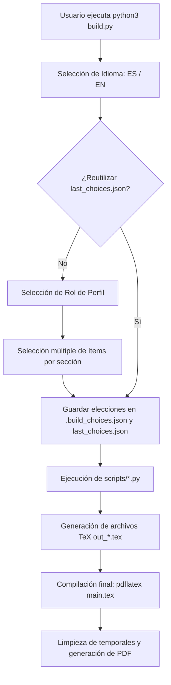

# Curriculum Vitae Modular & Automatizado en LaTeX

Sistema interactivo para generar currículums profesionales en LaTeX a partir de fuentes de datos JSON estructuradas, con soporte multilingüe (Español / Inglés) y selección granular de contenido.

---

## 🛠️ Estructura y Funcionamiento de los Scripts Python

El proyecto cuenta con un script orquestador (`build.py`) en la raíz y scripts auxiliares en la carpeta `scripts/` encargados de traducir los datos de cada sección al código LaTeX correspondiente.

### Resumen de Scripts

| Script | Funcionalidad Principal | Input(s) | Output(s) |
|---|---|---|---|
| [`build.py`](build.py) | **Orquestador CLI interactivo**: Menús de selección de idioma, rol y filtro de ítems; invoca scripts de sección y compila con `pdflatex`. | • Respuestas por terminal (idioma, rol, checkboxes)<br>• `json/*.json`<br>• `last_choices.json` (opcional) | • `.build_choices.json` (temporal)<br>• `last_choices.json`<br>• `scripts/out_*.tex`<br>• `CV_BrunoVelazquez_<Rol>_<Idioma>.pdf` |
| [`scripts/profile.py`](scripts/profile.py) | Genera el fragmento LaTeX del **Perfil Profesional** enfocado al rol seleccionado. | • `sys.argv[1]` (idioma `ES`/`EN`)<br>• `json/profile.json`<br>• `.build_choices.json` (rol) | • `scripts/out_profile.tex` |
| [`scripts/experience.py`](scripts/experience.py) | Genera el bloque LaTeX de **Experiencia Laboral** (`\resumeSubheading` y viñetas `\resumeItem`). | • `sys.argv[1]` (idioma `ES`/`EN`)<br>• `json/experience.json`<br>• `.build_choices.json` (índices) | • `scripts/out_experience.tex` |
| [`scripts/education.py`](scripts/education.py) | Genera el bloque LaTeX de **Educación** académica. | • `sys.argv[1]` (idioma `ES`/`EN`)<br>• `json/education.json`<br>• `.build_choices.json` (índices) | • `scripts/out_education.tex` |
| [`scripts/skills.py`](scripts/skills.py) | Genera la sección de **Habilidades Técnicas** en formato de tabla de 2 columnas (`tabular*`). | • `sys.argv[1]` (idioma `ES`/`EN`)<br>• `json/skills.json`<br>• `.build_choices.json` (índices) | • `scripts/out_skills.tex` |
| [`scripts/projects.py`](scripts/projects.py) | Genera la sección de **Proyectos Destacados** (`\resumeProjectHeading` y viñetas). | • `sys.argv[1]` (idioma `ES`/`EN`)<br>• `json/projects.json`<br>• `.build_choices.json` (índices) | • `scripts/out_projects.tex` |
| [`scripts/certifications.py`](scripts/certifications.py) | Genera la sección de **Certificaciones**. | • `sys.argv[1]` (idioma `ES`/`EN`)<br>• `json/certifications.json`<br>• `.build_choices.json` (índices) | • `scripts/out_certifications.tex` |
| [`scripts/languages.py`](scripts/languages.py) | Genera la sección de **Idiomas** y nivel de competencia. | • `sys.argv[1]` (idioma `ES`/`EN`)<br>• `json/languages.json`<br>• `.build_choices.json` (índices) | • `scripts/out_languages.tex` |
| [`scripts/leadership.py`](scripts/leadership.py) | Genera la sección de **Liderazgo y Actividades**. | • `sys.argv[1]` (idioma `ES`/`EN`)<br>• `json/leadership.json`<br>• `.build_choices.json` (índices) | • `scripts/out_leadership.tex` |

---

## ⚙️ Flujo de Ejecución



## 🚀 Uso Rápido

Para iniciar el asistente interactivo:

```bash
python3 build.py
```

Para generar un fragmento de sección de forma individual e independiente (ej. Experiencia en Inglés):

```bash
python3 scripts/experience.py EN
```
